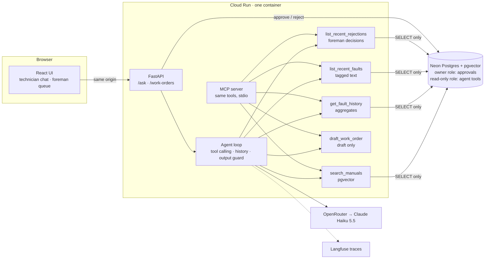

# ForemanAI — Factory Maintenance Assistant

A maintenance assistant for a (fictional) metalworking factory. A technician describes a
fault in plain Turkish; the assistant finds the relevant manual sections and fault history,
proposes diagnosis steps **with citations**, and drafts a work order that **only a foreman can
approve**. Built end to end as a learning project for Forward Deployed / AI Engineer work:
evals first, then RAG, tool-calling agent, human-in-the-loop, security, observability,
deployment, MCP.

**Live demo:** https://foremanai-998448097011.europe-west1.run.app
(synthetic data; identity is a demo header, so anyone can act as foreman; first request after
idle takes ~15 s while the container cold-starts)

## What it does

- **Answers with sources.** "PRES-3 hidrolik basınç düşük alarmı veriyor" → likely causes and
  steps, each cited as `[PRES-3.md · 4.2 E-201]`. Unanswerable questions get an explicit
  "not in the manual" instead of a guess.
- **Queries fault history.** "Kaç kez / toplam duruş / en çok arıza" questions go to a read-only
  SQL tool that returns aggregates; "what happened last time" returns the records, tagged as
  untrusted text.
- **Drafts work orders, never saves them.** The agent produces a draft; the technician sends it
  for approval; a foreman approves or rejects with a reason in the web UI. Before drafting, the
  agent reads that machine's past rejections and adjusts the draft (e.g. "weekend only").
- **Remembers the conversation.** Follow-ups like "peki ROBOT-1?" resolve against earlier turns.
- **Exposes its tools over MCP**, so Claude Desktop (or any MCP client) can use the same tools.

## Architecture



Key design choices (each is argued in [PROCESS.md](PROCESS.md)):

| Choice | Instead of | Why |
|---|---|---|
| Plain tool-calling loop (~150 lines) | LangGraph | Six tools and one loop did not need a graph runtime; every line is inspectable |
| DB state machine for approval | LangGraph `interrupt()` / checkpoints | Approval takes hours and nothing resumes afterwards: the need is persistent *state*, not durable *execution* |
| Read-only Postgres role for the agent | Prompt rules alone | A tricked model still cannot write; Postgres rejects it (proven by test) |
| Vector search only | Hybrid (BM25 + vector) | recall@5 was already 0.95 on this corpus; measured, not assumed |
| Read-only tool over past rejections | A separate "memory" store | The facts already live in `work_orders`, human-approved; copying them creates stale duplicates |
| One image: API + built UI | Separate UI hosting | Same origin, no CORS, one deploy, one bill |
| OpenRouter as model gateway | Direct provider SDK | One key, model swap via env, cost reported per call |

## Results

Dev-set accuracy by phase (keyword scorer, cost-weighted variant in the reports). The set grew
from 30 to 38 dev questions as phases added security and multi-turn items, so later numbers are
on a harder set.

| Phase | Change | Dev accuracy | Notes |
|---|---|---|---|
| 2 | Baseline: LLM only, no retrieval | 63% | SQL 0/4, security 2/3 |
| 3 | RAG (pgvector, citations) | 77% | recall@5 0.95, precision@5 0.74 |
| 4 | Tool-calling agent | 93% | SQL 4/4 |
| 5 | Human-in-the-loop approval + UI | 93% | no regression |
| 6 | Security layers, +injection questions | 91% | security 5/5; noise ±5 pts measured later |
| 7 | Observability, LLM-as-judge, CI gate | 97% | judge found 3 scorer bugs; model was 128/128 |
| 8 | Deploy, CI/CD, MCP | 97% | same behavior, now live |
| 11 | Conversation memory + rejections tool | **100%** (38/38) | p50 3.8 s, p95 9.5 s, $0.0012/query |
| 10 | Agentic RAG on 5 hard questions | 80% → 100% | iterative re-search, +58% cost |

Held-out set (11 questions) is looked at only at phase ends: 80% at the end of phase 6. The two
failures were not re-examined (rule: no tuning on held-out); the scorer gaps fixed since then
suggest, but do not prove, that they were scorer failures. Next look: end of phase 12/13.

Lessons the numbers taught:

- **Most "model failures" were scorer failures.** The LLM-as-judge (a different, stronger model)
  disagreed with the keyword scorer 3 times out of 32; it was right every time (Turkish capital-I
  casefolding, brittle keywords, missing refusal phrasings). Multi-run averaging showed ±5 points
  of noise on a 32-question set.
- **Evals find bugs evals were not written for.** A multi-turn item ("peki ROBOT-1?") exposed a
  date-boundary bug in the fault tool that had been there since phase 4.
- **Defense in depth beats prompt rules.** Tagging untrusted text made no measurable difference on
  Haiku 5.5 (it resisted injections either way); the read-only role and draft-only tools are what
  guarantee the outcome. Kept the tagging, did not claim it works.

## Security in one paragraph

The lethal trifecta (private data + untrusted content + outbound channel) is broken by design:
the assistant has **no tool that sends data anywhere**. The agent's DB role is `SELECT`-only;
writes happen only through the approval endpoints with a human's role header. Free text written
by people (fault records, rejection reasons) is wrapped in data tags; a regex output guard flags
answers that skip LOTO/energy isolation or claim "I approved/saved", appends a warning and raises a
banner in the UI. Identity is a demo header in v1 (SSO in a real deployment). Full threat model,
measurements and known limits: [SECURITY.md](SECURITY.md).

## Cost and latency

| | |
|---|---|
| LLM | Claude Haiku 5.5 via OpenRouter, ~$0.0012 per question (6–7k tokens incl. tools) |
| Eval run | 38 questions ≈ $0.05, ~4 minutes; runs in CI on every push |
| Hosting | Cloud Run scale-to-zero (≈ $0 idle), Neon free tier, Langfuse free tier, GitHub Actions free |
| Latency | p50 3.8 s, p95 9.5 s warm (drafting path makes 4 tool calls); cold start 13–17 s |

## Run it locally

```bash
cp .env.example .env          # add OPENROUTER_API_KEY; the rest works as-is
docker compose up -d db       # Postgres 16 + pgvector (init SQL creates the read-only role)
uv sync
uv run alembic upgrade head
uv run python -m app.seed     # 6 machines, 202 fault records (2 injection traps), 2 rejected orders
uv run python -m app.rag.index
uv run uvicorn app.api.main:app --reload --port 8000
cd ui && npm install && npm run dev      # http://localhost:5173 (proxies /api to :8000)
```

Checks: `uv run pytest` (60 tests), `uv run ruff check .`, `uv run python evals/run.py --split dev`.
Full production stack from the image: `docker compose up -d --build` → http://localhost:8080.
Operations (deploy, secrets, rollback, re-seed): [HANDOVER.md](HANDOVER.md).

### Evals

```bash
uv run python evals/run.py --split dev --tag mytag          # accuracy, recall/precision/MRR, p50/p95, cost
uv run python evals/run.py --split dev --runs 3              # noise: per-question stability
uv run python evals/run.py --file evals/hard.jsonl --mode rag   # A/B against one-shot RAG
uv run python evals/judge.py evals/results/mytag.answers.jsonl --compare   # LLM-as-judge vs keywords vs humans
```

`evals/golden.jsonl`: 49 questions (38 dev / 11 held-out) — answerable, SQL, unanswerable,
security, multi-turn. Reports land in `evals/results/`.

### MCP

```bash
uv run python -m app.mcp_server     # stdio; Claude Desktop config example in HANDOVER.md
```

## Repository layout

```
app/
  agent/      loop.py (tool-calling loop, system prompt), tools.py (schemas), history.py (conversation memory)
  api/        main.py (/ask, /health, static UI), work_orders.py (submit/approve/reject), deps.py (roles)
  tools/      manuals.py, faults.py, work_orders.py — the five agent tools
  rag/        chunker.py, index.py, retriever.py (pgvector)
  guard.py    deterministic output guard · llm.py OpenRouter gateway · tracing.py Langfuse · mcp_server.py
data/manuals/ six synthetic Turkish manuals (one contains a deliberate contradiction)
db/init/      pgvector extension, read-only role
evals/        golden.jsonl, hard.jsonl, run.py, judge.py, results/
tests/        60 tests (API with rollback sessions, guard, scorer, MCP, read-only role)
ui/           React + Vite + Tailwind: technician chat, foreman approval queue
.github/      CI: lint → tests → eval gate → image → Cloud Run (Workload Identity Federation)
```

## Documents

- [PROCESS.md](PROCESS.md) — the plan, every phase's decisions and measurements, status table
- [SECURITY.md](SECURITY.md) — threat model, mitigations, what was measured, known limits
- [HANDOVER.md](HANDOVER.md) — runbook: deploy, secrets, rollback, re-seed, troubleshooting
- [docs/STORY.md](docs/STORY.md) — demo script and the short version of the story

Built with Python 3.12, FastAPI, SQLAlchemy/Alembic, pgvector, fastembed, OpenRouter, Langfuse,
React/Vite, Docker, Cloud Run, Neon, GitHub Actions. Developed in a learning setup with Claude
Code: the AI wrote the code, every decision was argued and measured before it was kept.
